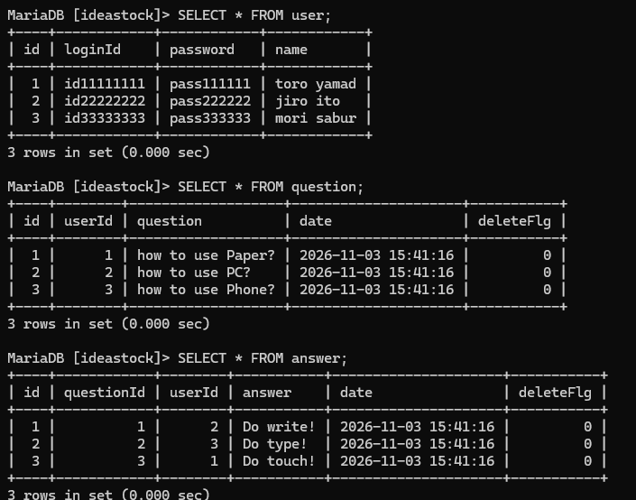

# DB環境構築方法

## dbとテーブルとダミーデータ一式をMySQLにロードするには?
本フォルダ中にある**02.開発用DB環境構築.bat**をダブルクリックするだけで、ideastockデータベースとuser/question/answerテーブル一式とダミーデータがロードされる。 
 
再び初期のダミーデータ状態に戻したい場合は、**03.DB環境削除.bat**をダブルクリックすればideastockデータベース自体が削除されるので再び**02.開発用DB環境構築.bat**をダブルクリックすれば初期のダミーデータ装填済み状態に戻せる。

## ダミーデータを除くdbとテーブルを作成するには?
本フォルダ中にある**01.本番用DB環境構築.bat**をダブルクリックすればダミーデータなしのideastockデータベースとuser/question/answerテーブル一式がロードされる。

|ファイル名|備考|
|---|---|
|01.本番用DB環境構築.bat|ダミーデータを除くデータベースとテーブルをロードするためのバッチファイル|
|02.開発用DB環境構築.bat|ダミーデータ込みのデータベースとテーブルをロードするためのバッチファイル|
|03.DB環境削除.bat|上記のバッチファイルで作成したデータベースとテーブルを全削除するためのバッチファイル|
|DeleteEnv.sql|ideastockデータベース自体を削除する処理の記されたsqlスクリプト|
|SetUpDevEnv.sql|開発用DB環境を構築する処理の記されたsqlスクリプト|
|SetUpProductEnv.sql|本番用DB環境を構築する処理の記されたsqlスクリプト|

## ダミーデータの内容
